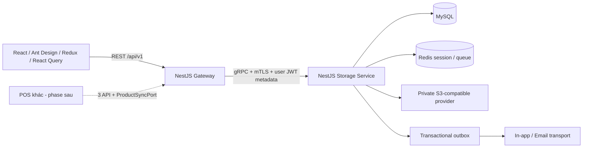

> Bản chia sẻ PUB-R1 · 05/11/2026. Nội dung kế hoạch/baseline là snapshot theo revision gốc; xem [TEAM-HANDOFF](../../TEAM-HANDOFF.md) để biết phân công mới. Link đã chuyển cho repo; SHA nguồn và SHA bản xuất ở PUBLICATION-MANIFEST.json. Phát hành Git không tự đóng gate/code/test.

# Kiến trúc và ranh giới thực thi — baseline R2

**APPROVED FOR DESIGN — Codex điều phối theo ủy quyền, 05/11/2026.** Nguồn: D23 ADR-001/002/003/006; D21; D03/D06/D08/D14/D30–D32. Đây là kiến trúc đích, chưa phải dịch vụ đang chạy.

## Thành phần được chọn

- **Gateway** sở hữu HTTP, CORS/CSRF/cookie, ValidationPipe ở biên, request/response mapping, upload streaming, traceId và deadline. Gateway không có connection/user DB nghiệp vụ, không ghi audit bằng transaction riêng.
- **Storage Service** sở hữu danh mục, user/role/session, phiếu/tồn/lô/ledger, file metadata, audit/outbox và job metadata. Các module tái sử dụng từ source hiện tại, không tách một transaction tồn thành nhiều service.
- **MySQL** là nguồn chuẩn nghiệp vụ. Redis không là sổ tồn/công nợ; mất Redis không được làm mất bút toán. Cache quyền có epoch/invalidation; fail-closed khi không xác minh được session/quyền, không cho phép âm hoặc bypass vì cache lỗi.
- **S3 provider** lưu object private. DB giữ key/checksum/size/MIME/purpose/owner/entity. Ghi DB rollback không được để metadata thành ATTACHED cho object chưa tồn tại; object tạm có TTL cleanup theo D06, không xóa tệp đã tham chiếu.
- **Outbox** được insert cùng transaction nghiệp vụ. Dispatcher chỉ publish sau commit; consumer có eventId dedupe. Retry không tái ghi tồn/tiền. Không có SMS transport trong phase hiện tại theo D22-R2.
- **POS**: contract/core ba endpoint tồn/công thức/xuất được thực hiện; vendor-specific adapter và live acceptance thuộc FUT-POS. Không tạo manual product CRUD thay thế một cách ngầm định.

## Đường tin cậy

1. Browser gửi access JWT trong Authorization; refresh chỉ cookie HttpOnly. Không tin userId/role/scope trong body/query/header tự đặt.
2. Gateway kiểm chữ ký/issuer/audience/expiry, Origin/CSRF ở refresh-cookie endpoints và format payload. JWT gốc được chuyển trong gRPC metadata; không tạo identity mới từ body.
3. Gateway và Storage xác thực service identity bằng mTLS; chỉ Gateway identity hợp lệ được gọi RPC. Storage tự kiểm JWT/session/idle/role-epoch, quyền, scope và row-level ownership trước truy cập DB. Login/refresh chưa có accessJWT nhưng vẫn cần service identity và validation riêng.
4. TraceId do Gateway sinh/chuẩn hóa UUID; mọi RPC/outbox/audit chứa cùng traceId. Không ghi access/refresh/password/file bytes vào log. Request deadline được truyền, hủy stream phải cleanup object tạm.
5. Local contract compile không được gọi mTLS/TLS runtime PASS. PKI/self-signed cert test chỉ dùng khi task triển khai có target được cấp; vận hành thực theo gate D16/D31.

## Wire contracts

- `openapi-v1.json`: request/response/HTTP error/role/authority/scope target; các URL `warehouse.invalid` chỉ là địa chỉ thiết kế.
- `warehouse-storage.proto`: RPC typed; tiền/số lượng là string thập phân. `proto-field-map.json` định nghĩa JSON name, required/nullable và miền enum.
- `PATCH/PUT`: FieldMask dùng đường dẫn `data.<field>`; explicit JSON null vào `clear_fields`, omitted không được tự clear. FieldMask/clear_fields phải nằm trong whitelist và không được chồng lấn. Proto3 required/presence không thay validation nghiệp vụ.
- RPC file upload là client stream: header duy nhất đầu tiên, chunk≤64KiB, giới hạn tổng bytes theo purpose; không chờ buffer vô hạn. Nhánh lỗi/khách hủy không attach object.
- Các field dynamic `google.protobuf.Struct` chỉ dùng audit before/after và custom report rows; không dùng generic JSON command để né typed business contract. Decimal trong Struct vẫn là string.

## Tách source hiện tại và chuyển đổi

1. Giữ API legacy hoạt động trong task tương thích; không chuyển React callers sang v1 trước khi Gateway/Storage đủ contract tests. Không đổi một URL legacy thành UUID-path nếu client vẫn gửi slug.
2. Tách composition root: Storage giữ module/entity/transaction; Gateway mới không import TypeORM business repositories. Proto/client adapter có contract tests trước khi chuyển route.
3. Chuyển từng route có operationId, legacy alias/map và error translation rõ. Legacy `hasPrevios`/upload message giữ nguyên cho client cũ; v1 dùng `hasPrevious` và typed result.
4. Auth cookie/rotation, private file và audit/outbox có migration/backfill/rollback; không bật feature cho dữ liệu cũ chưa reconciliation. Kiểm đã chạy code+migration+cache invalidation trên target test riêng trước handoff.
5. Ant Design/Redux shell và common controls trước; chuyển từng feature, không rewrite toàn UI trong một thay đổi. Source Zustand/shadcn hiện tại chưa phải đích đã được duyệt.
6. Có WIP upload/lint từ worker khác; không sửa/revert. `entry-wip.json` và `carryover-alignment.md` ghi phần tái sử dụng và các gap trước khi nhận vào baseline.

## Lỗi gRPC → HTTP

| gRPC | HTTP | Xử lý |
|---|---:|---|
| UNAUTHENTICATED | 401 | Hết phiên/idle/revoked; refresh chỉ theo policy, không loop vô hạn |
| PERMISSION_DENIED | 403 | Thiếu quyền/family ceiling/tự duyệt |
| NOT_FOUND | 404 | Không tồn tại hoặc ngoài scope cần che existence |
| INVALID_ARGUMENT | 422 | Field/file validation, có code/field errors |
| FAILED_PRECONDITION / ABORTED | 409 | Version/state/khóa kho/thiếu tồn; không tự retry confirm bằng key mới |
| RESOURCE_EXHAUSTED | 429 | Rate limit; lỗi size/type dùng chi tiết FileException/422 riêng |
| UNAVAILABLE | 503 | Service/DB/Redis bắt buộc chưa sẵn sàng; không fail-open |
| DEADLINE_EXCEEDED | 504 | Kết quả chưa rõ; tra cứu bằng idempotency key, không ghi lặp |
| INTERNAL | 500 | Message an toàn + traceId, không stack/secret |

Business error details giữ mã/field/traceId trong metadata gRPC đã được validate. Gateway không phân loại lỗi bằng regex trên message.
