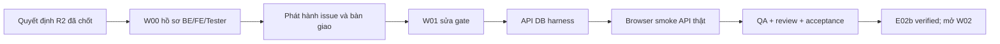

> Bản chia sẻ PUB-R1 · 05/11/2026. Nội dung kế hoạch/baseline là snapshot theo revision gốc; xem [TEAM-HANDOFF](../../../TEAM-HANDOFF.md) để biết phân công mới. Link đã chuyển cho repo; SHA nguồn và SHA bản xuất ở PUBLICATION-MANIFEST.json. Phát hành Git không tự đóng gate/code/test.

<!-- warehouse-plan:WH-PLAN-W00-W01-20261105-R1:W00 -->
# W00 — Kế hoạch kiểm soát R1

Mã tài liệu: WH-PLAN-W00-20261105-R1. Trạng thái: APPROVED FOR EXECUTION PLANNING. Phê duyệt: Codex — Điều phối theo ủy quyền người dùng ngày 05/11/2026. Ngày05/11/2026, Asia/Ho_Chi_Minh.

## Mục đích và phạm vi

Hồ sơ thiết kế R2 đã hoàn thành; issue này theo dõi bàn giao/tiếp nhận, không mở lại thiết kế hoặc reset trạng thái W00.

Baseline WH-DEC-20261105-R2 (37 quyết định APPROVED theo ủy quyền điều phối). POS thật và SMS phase sau; gRPC/Ant Design foundation thuộc W02. W00 đã hoàn thành hồ sơ, chưa có package product acceptance. W01 sửa gate và dựng harness trên test target mới; không dùng DB hiện hữu, `.env`, CI/CD hoặc deploy.

Đội1BE:1FE:1Tester; vị trí BE01/FE01/QA01, chưa tự gán tên/assignee. WIP upload hiện hữu giữ ownership file module/authority/main/lint và migration047, không giao trùng.

R2 là thiết kế đích: /api/v1 typed contracts chưa phải endpoint đang chạy. W01 smoke dùng legacy API thực tế (POST /auth/login, GET /auth/me, GET /warehouses); không kiểm future API bằng mock rồi báo tích hợpPASS. Refresh-cookie/idle/fullRBAC kiến trúc đích kiểm ở W02 sau implement.

## Phase, task và phụ thuộc

| Task | Vai trò | Effort | Phụ thuộc | Issue |
|---|---|---:|---|---|
| W00-BE Bàn giao contract API, dữ liệu, quyền và migration | BE | 0–0 | Không | https://github.com/homeslands/warehouse/issues/158 |
| W00-FE Bàn giao screen contract, trạng thái UI và phạm vi frontend | FE | 0–0 | Không | https://github.com/homeslands/warehouse/issues/159 |
| W00-QA Bàn giao test basis, fixture và grant môi trường test | QA | 0–0 | Không | https://github.com/homeslands/warehouse/issues/160 |

## Bảng tiến độ lúc phát hành

- [ ] https://github.com/homeslands/warehouse/issues/158: DOCUMENTATION_COMPLETE_RECEIPT_PENDING — Bàn giao contract API, dữ liệu, quyền và migration
- [ ] https://github.com/homeslands/warehouse/issues/159: DOCUMENTATION_COMPLETE_RECEIPT_PENDING — Bàn giao screen contract, trạng thái UI và phạm vi frontend
- [ ] https://github.com/homeslands/warehouse/issues/160: DOCUMENTATION_COMPLETE_RECEIPT_PENDING — Bàn giao test basis, fixture và grant môi trường test

## Điều kiện hoàn thành

Hồ sơ có nguồn/hash/CR, checklist issue liên kết đầy đủ; BE/FE/Tester thực nhận phần được giao. Người chưa nhận giữ pending; không giả chữ ký hoặc đóng product acceptance. W00 handover receipt không phải câu hỏi nghiệp vụ mới chặn W01 đọc baseline.

## Kiểm soát thay đổi và tiến độ

Checkpoint đầu/cuối ngày làm việc do người thực hiện cập nhật thủ công, không tạo scheduler/CI. Issue tạo/open/closed khác task COMPLETE và package ACCEPTED. Khi bắt đầu ghi actor/actual_start; khi giao QA ghi diff+evidence; khi block ghi owner/unlock. Thay thiết kế R2 phải CR/revision, không sửa signed hash. Phụ thuộc thật làm thời gian W01 chi tiết8–14 thay cửa sổ tổng quát7–12 ở R2; effort không tăng, rolling reforecast dự án sau W01.

## Nguồn và hồ sơ

- SRC-01 — Baseline quyết định R2; SHA256 `a2f836650b3ced1b4b29a3bb8c03b55d29ca6b7ec74e2e616a59b8c758f9e070`; đường dẫn local tương đối `.agents/tasks/preimplementation-gates-20261105/approvals/r2/decision-pack.json` (không có trên GitHub).
- SRC-02 — Kế hoạch R2 đội1:1:1; SHA256 `4e2297e24a97da80ef0df80739e9f1eef2d63113332940467d512717a95bddb5`; đường dẫn local tương đối `.agents/tasks/preimplementation-gates-20261105/planning/plan.json` (không có trên GitHub).
- SRC-03 — Gate và bằng chứng; SHA256 `a3cdc81a6e40177766dcec4941bf38d85fb8849f7e6e94f1231ae3d15f9e719c`; đường dẫn local tương đối `.agents/tasks/preimplementation-gates-20261105/gates.json` (không có trên GitHub).
- SRC-04 — Dossier W00; SHA256 `87d10bea82cf212635efa152b11f609f4234b970287f7b7e1e6603b0789fe275`; đường dẫn local tương đối `.agents/tasks/preimplementation-gates-20261105/dossiers/W00.json` (không có trên GitHub).
- SRC-05 — Dossier W01; SHA256 `63669bfa727f31b8f2226656553f9a712b4db46ad9318ad7533ec6b3dd529234`; đường dẫn local tương đối `.agents/tasks/preimplementation-gates-20261105/dossiers/W01.json` (không có trên GitHub).
- SRC-06 — Fixture 8actor/3kho; SHA256 `d78e5a2c5c021431b1128478a77470c24884d54117d95368ffb911d2a4825470`; đường dẫn local tương đối `.agents/tasks/preimplementation-gates-20261105/qa/fixture-plan.json` (không có trên GitHub).
- SRC-07 — Grant test local; SHA256 `20fd89e74b7c8e7b76240a2b8346cee60b8ff8dc70667613d5de7e6a69f9e1e6`; đường dẫn local tương đối `.agents/tasks/preimplementation-gates-20261105/environment/HANDOFF.md` (không có trên GitHub).
- SRC-08 — Carryover upload; SHA256 `bcd5421891a9124d9e03abd77372204ac9efec3b3a1c84d2d0db0315140e8314`; đường dẫn local tương đối `.agents/tasks/preimplementation-gates-20261105/carryover-alignment.md` (không có trên GitHub).
- SRC-09 — Audit API compile cũ; SHA256 `0e330d011e92d3cc6354a8cd941ed5114a9c088e5dd6478634356914b01e8767`; đường dẫn local tương đối `.agents/tasks/audit-20261104/evidence/api-typecheck.log` (không có trên GitHub).
- SRC-10 — Audit UI full check cũ; SHA256 `dddce18843cea07d8f45e16ec8c83c0932e312ec0d2ea09d5c82a7ca58860ade`; đường dẫn local tương đối `.agents/tasks/audit-20261104/evidence/ui-check.log` (không có trên GitHub).

Các đường dẫn trên là local-only. Issue này chứa checklist/acceptance để đọc trực tiếp; điều phối cấp gói hồ sơ được kiểm soát và quyền test riêng qua handoff, không đăng credential/config nội bộ lên GitHub.

## Tailoring ISO

- [ISO/IEC/IEEE 15289:2019](https://www.iso.org/standard/74909.html): Tổ chức mục đích, nội dung và kiểm soát hồ sơ vòng đời; mã tài liệu, phiên bản, nguồn, trách nhiệm và đầu ra.
- [ISO/IEC/IEEE 29148:2018](https://www.iso.org/standard/72089.html): Nguồn yêu cầu, truy vết sang task/case, acceptance criteria và kiểm soát thay đổi yêu cầu.
- [ISO/IEC/IEEE 29119-3:2021](https://www.iso.org/standard/79429.html): Test plan, test design, case/procedure, execution record, incident và test completion report.
- [ISO 21502:2020](https://www.iso.org/standard/74947.html): Lập WBS, trách nhiệm, phụ thuộc, nguồn lực, mốc, rủi ro và báo cáo tiến độ.

Cấu trúc hồ sơ tham chiếu phạm vi công khai của các tiêu chuẩn; không tự tuyên bố chứng nhận hoặc tuân thủ toàn bộ điều khoản.
